<div align="center">



# ⚡ Awesome Log Aggregation & Management 🪵

<p align="center">
  <a href="https://github.com/ishandutta2007/Awesome-Awesome-Awesome"></a><a href="https://discord.gg/jc4xtF58Ve"></a>
  <a href="https://github.com/ishandutta2007/Awesome-Log-Aggregation-Management/stargazers"></a>
  <a href="https://github.com/ishandutta2007/Awesome-Log-Aggregation-Management/network/members"></a>
  <a href="https://github.com/ishandutta2007/Awesome-Log-Aggregation-Management/blob/main/LICENSE"></a>
  <a href="https://github.com/ishandutta2007"></a>
</p>

<p align="center">
  <strong>A curated list of top SaaS platforms and open-source GitHub projects for log aggregation, centralized log collection, full-text search, distributed stream processing, and self-hosted observability pipelines.</strong>
</p>

<p align="center">
  <em>Last updated: October 2026</em>
</p>

</div>

---

## 📑 Table of Contents

- [🌐 Sector Overview & Market Dynamics](#-sector-overview--market-dynamics)
- [☁️ SaaS / Hosted Log Management Platforms](#️-saas--hosted-log-management-platforms)
- [💻 Open-Source Log Aggregation & Analytics Engines](#-open-source-log-aggregation--analytics-engines)
  - [1. SigNoz](#1--signoz)
  - [2. Grafana Loki](#2--grafana-loki)
  - [3. Vector](#3--vector)
  - [4. OpenObserve](#4--openobserve)
  - [5. VictoriaMetrics / VictoriaLogs](#5--victoriametrics--victorialogs)
  - [6. Logstash](#6--logstash)
  - [7. OpenSearch](#7--opensearch)
  - [8. Fluentd](#8--fluentd)
  - [9. Quickwit](#9--quickwit)
  - [10. Fluent Bit](#10--fluent-bit)
  - [11. Graylog](#11--graylog)
  - [12. Parseable](#12--parseable)
- [🛠️ Architectural Guidance & Indexing Strategies](#️-architectural-guidance--indexing-strategies)
- [🤝 How to Contribute](#-how-to-contribute)
- [💖 Support & Sponsorship](#-support--sponsorship)
- [📈 Star History](#-star-history)
- [⚠️ Disclaimer](#️-disclaimer)

---

## 🌐 Sector Overview & Market Dynamics

The global log management and cloud observability market is valued at approximately **$3.7B to $4.4B** and is projected to expand toward **$9B to $13B+** over the next decade at a CAGR of roughly **11% to 15.6%**. 

The sector is **moderately fragmented** rather than a winner-take-all monopoly: while market-cap titans like Datadog, Cisco (Splunk), and Elastic dominate high-scale enterprise contracts, intense pricing pressure from ballooning cloud log volumes has catalyzed widespread adoption of developer-friendly challenger SaaS (Better Stack, Logz.io) and object-storage-native open-source engines (Loki, Quickwit, OpenObserve, VictoriaLogs).

---

## ☁️ SaaS / Hosted Log Management Platforms

*Ranked and sorted in descending order by company scale (market capitalization / enterprise acquisition valuation).*

| Company / Product | Scale / Valuation | Starting Paid Tier Pricing | Free Tier / Trial Limits | Key Strengths & Use Cases |
| :--- | :--- | :--- | :--- | :--- |
| **[Datadog](https://www.datadoghq.com/)** | ~$88B – $93B Market Cap | **$0.10 / GB ingested** + indexing from **$1.06 per 1M events** (3-day retention) | **14-day free trial** with full platform capabilities and integrations across unlimited hosts | Comprehensive all-in-one observability correlating distributed tracing (APM), real-time infrastructure metrics, network monitoring, and security telemetry. |
| **[Splunk Cloud](https://www.splunk.com/)** | ~$28B Acquisition (Cisco) | Starting from ~**$1,800 – $2,500 / GB/day** annual commitment (~$150/GB/month list equivalent) | **14-day free trial** with hosted access up to **5 GB data ingestion per day** (no credit card required) | The gold standard for enterprise log intelligence, audit compliance, and SecOps/SIEM with SPL (Search Processing Language) querying petabyte-scale machine data. |
| **[Elastic Cloud](https://www.elastic.co/cloud/)** | ~$10B Market Cap | Standard tier begins at **$99 / month** (scales linearly with allocated compute and storage units) | **14-day free trial** with full feature access and preconfigured deployment templates (no credit card required) | Managed Elasticsearch, Logstash, and Kibana (ELK) delivering rich Lucene-based full-text indexing, vector search, and customizable dashboard visualizations. |
| **[Sumo Logic](https://www.sumologic.com/)** | ~$1.7B Acquisition (Francisco Partners) | Essentials tier starts at **$90 / month** (~3 GB to 5 GB/day ingest with 30-day retention) | **Permanent Free Tier** (20 credits/day, ~500 MB/day, 7-day retention, 3 users) + **30-day trial** up to **1 GB/day** with 20 users | Cloud-native multi-tenant analytics platform purpose-built for continuous security monitoring, PCI-DSS/HIPAA audit trails, and DevSecOps troubleshooting. |
| **[Logz.io](https://logz.io/)** | ~$350M – $450M Est. Valuation | Consumption tier starts at **$0.92 / GB/day** ingested (includes 7-day hot retention) | **14-day free trial** allowing up to **5 GB / day** data ingestion, 4-day retention, and unlimited user accounts | Turnkey managed OpenSearch, OpenSearch Dashboards, and Jaeger tracing with automated log pattern clustering and AI-assisted troubleshooting. |
| **[Better Stack Logs](https://betterstack.com/logs)** | ~$50M – $100M Est. Valuation ($28M raised) | Pay-as-you-go from **$0.10 / GB ingest** + **$0.05 / GB-month retention** (or Nano bundle at **$25 / month**) | **Permanent Free Tier** with **3 GB / month** logs, 3-day data retention, 100k error exceptions, and 30 GB metrics | High-performance, developer-first logging engine backed by ClickHouse, featuring lightning-fast SQL queries, live tailing, and native uptime monitoring integration. |

---

## 💻 Open-Source Log Aggregation & Analytics Engines

*Open-source GitHub repositories ranked in descending order by GitHub stargazers count.*

### 1. 🚀 [SigNoz](https://github.com/SigNoz/signoz) [](https://github.com/SigNoz/signoz/stargazers)
* **Description**: OpenTelemetry-native full-stack APM and observability platform using ClickHouse as its columnar datastore.
* **Architecture**: Direct OTLP ingestion on ports `4317` / `4318`. Ingests logs, metrics, and distributed traces into a unified single-pane interface.
* **Best For**: Engineering teams standardizing on OpenTelemetry who want an open-source Datadog alternative without per-host licensing fees.

### 2. ⚡ [Grafana Loki](https://github.com/grafana/loki) [](https://github.com/grafana/loki/stargazers)
* **Description**: The industry standard for cost-efficient, label-indexed log aggregation—designed as "like Prometheus, but for logs."
* **Architecture**: Indexes only metadata labels rather than entire raw message text, storing compressed chunks in cheap object storage (S3/GCS/MinIO).
* **Latest Updates**: Features results caching for the Thor query engine, case-insensitive regex execution, and Logline query-acceleration indexing.
* **Best For**: Kubernetes clusters and teams already leveraging Grafana and Prometheus seeking minimal compute/storage overhead.

### 3. 🦀 [Vector](https://github.com/vectordotdev/vector) [](https://github.com/vectordotdev/vector/stargazers)
* **Description**: Ultra-high-performance, memory-safe observability data pipeline written in Rust for capturing, transforming, and routing telemetry.
* **Architecture**: Features the Vector Remap Language (VRL) for real-time parsing, filtering, log masking, and adaptive multi-sink fanout.
* **Best For**: Edge collectors, ingress proxies, and central pipeline gateways routing terabytes of raw logs across multiple SIEM and storage backends.

### 4. 🔭 [OpenObserve](https://github.com/openobserve/openobserve) [](https://github.com/openobserve/openobserve/stargazers)
* **Description**: Cloud-native, high-throughput observability platform written in Rust with stateless compute and object-storage architecture.
* **Architecture**: Built on Apache Arrow and DataFusion; provides 140x lower storage costs than Elasticsearch, unified logs, metrics, traces, and LLM observability.
* **Latest Updates**: Includes AI Observability (annotation queues, playground testing), composite alert rules, SLO burn rates, and open-source Synthetics.
* **Best For**: Teams needing a single, resource-efficient self-hosted platform covering APM, log search, and generative AI trace telemetry.

### 5. 📊 [VictoriaMetrics / VictoriaLogs](https://github.com/VictoriaMetrics/VictoriaMetrics) [](https://github.com/VictoriaMetrics/VictoriaMetrics/stargazers)
* **Description**: High-capacity, cost-effective log management engine designed to process structured and unstructured logs with unmatched compression ratios.
* **Architecture**: Features LogsQL query language, sub-second search times, up to 30x compression over raw logs, and seamless integration alongside VictoriaMetrics time-series.
* **Best For**: High-throughput environments wanting predictable CPU/RAM footprints and simple single-binary or clustered operational models.

### 6. 🔄 [Logstash](https://github.com/elastic/logstash) [](https://github.com/elastic/logstash/stargazers)
* **Description**: The veteran server-side data processing pipeline of the Elastic Stack that ingests data from a multitude of sources simultaneously.
* **Architecture**: Extensible plugin ecosystem (hundreds of inputs, filters like Grok, and outputs) for transforming, mutating, and enriching log streams before indexing.
* **Best For**: Complex enterprise legacy systems requiring sophisticated schema normalization, Grok pattern parsing, and multi-destination ingestion.

### 7. 🔎 [OpenSearch](https://github.com/opensearch-project/OpenSearch) [](https://github.com/opensearch-project/OpenSearch/stargazers)
* **Description**: The 100% open-source (Apache 2.0) distributed search and analytics suite forked from Elasticsearch and Kibana.
* **Architecture**: Built upon Apache Lucene; features distributed index sharding, OpenSearch Dashboards, neural search, and sparse index representations.
* **Latest Updates**: Built on Lucene 10, delivering up to 60% lower search latency compared to 2.x and up to 80% versus 1.x.
* **Best For**: Organizations demanding true open-source licensing without Elastic dual-license restrictions while maintaining full-text search power.

### 8. 🌊 [Fluentd](https://github.com/fluent/fluentd) [](https://github.com/fluent/fluentd/stargazers)
* **Description**: CNCF graduated cross-platform log collector that unifies data collection and consumption with a unified JSON logging layer.
* **Architecture**: Pluggable Ruby/C architecture with over 1,000 community plugins connecting to cloud storage, databases, message queues, and analytical stores.
* **Best For**: Enterprise microservice architectures requiring robust buffering, multi-sink routing, and unified logging standards.

### 9. ⚡ [Quickwit](https://github.com/quickwit-oss/quickwit) [](https://github.com/quickwit-oss/quickwit/stargazers)
* **Description**: Sub-second full-text search engine written in Rust, purpose-designed to operate natively on top of cloud object storage (Amazon S3, Azure Blob, GCS).
* **Architecture**: Completely decouples compute from storage. Splitting queries into leaf and root nodes enables executing fast full-text queries against 100TB+ datasets.
* **Latest Updates**: Features Ingest V2 as default, AWS Lambda leaf-search offloading, Jaeger v2 endpoint compatibility, and Trino-compatible Elasticsearch APIs.
* **Best For**: Petabyte-scale log aggregation, audit logging, and tracing where running persistent stateful SSD clusters is cost-prohibitive.

### 10. 🏎️ [Fluent Bit](https://github.com/fluent/fluent-bit) [](https://github.com/fluent/fluent-bit/stargazers)
* **Description**: Extremely lightweight, fast, and low-footprint log, metric, and trace shipper written in C (part of the CNCF Fluent project).
* **Architecture**: Minimal memory footprint (~500KB to 2MB RAM), zero dependencies, asynchronous I/O, and native parsing filters for Kubernetes containers.
* **Best For**: Kubernetes DaemonSets, IoT edge computing devices, embedded systems, and containerized cloud environments.

### 11. 🛡️ [Graylog](https://github.com/Graylog2/graylog2-server) [](https://github.com/Graylog2/graylog2-server/stargazers)
* **Description**: Mature, enterprise-grade centralized log management and SIEM platform offering deep security analysis and threat alerting.
* **Architecture**: Java backend utilizing MongoDB for configuration state and Elasticsearch/OpenSearch as the underlying search engine.
* **Latest Updates**: Version 7.0 includes Asset Events risk scoring, vulnerability scanning integration (Qualys/Tenable), AI dashboard summaries, and MCP tooling for LLMs.
* **Best For**: Enterprise security operations teams (SecOps) requiring audit tracking, alert correlation, and compliance frameworks.

### 12. 📦 [Parseable](https://github.com/parseablehq/parseable) [](https://github.com/parseablehq/parseable/stargazers)
* **Description**: Lightweight, cloud-native log analytics and storage engine written in Rust, leveraging Apache Parquet and S3 object storage.
* **Architecture**: Stores logs natively as columnar Parquet files; queries data directly using standard SQL without needing index maintenance.
* **Best For**: Developers seeking a lightweight, modern SQL-friendly logging backend without the heavy operational overhead of legacy clusters.

---

## 🛠️ Architectural Guidance & Indexing Strategies

Choosing the right log aggregation platform hinges on understanding the trade-off between **Indexing Overhead** and **Query Latency**:

```
[ Log Producers / Apps ]
           │
           ▼
[ High-Throughput Shippers ]  ── (Fluent Bit / Vector / Logstash)
           │
     ┌─────┴─────────────────────────────────┐
     ▼                                       ▼
【 Label-Indexed / Object-Native 】     【 Full-Text Lucene / Inverted Index 】
  • Grafana Loki                         • Elastic Cloud / OpenSearch
  • Quickwit                             • Graylog
  • Parseable                            • Datadog / Splunk
 (Low compute, cheap S3 storage,        (Fast free-text queries, instant search,
  needle search requires scans)          higher RAM/SSD cluster costs)
```

1. **Needle-in-a-Haystack Queries**: If your primary workflow requires arbitrary string search on raw error traces across months of logs, prioritize full-text indexing solutions like **OpenSearch**, **Quickwit**, or **Elasticsearch**.
2. **Predictable Cloud Budgets**: If high ingestion volumes are driving unsustainable bills, choose metadata-indexing or object-storage-first engines like **Grafana Loki**, **Quickwit**, or **VictoriaLogs**.
3. **Unified Telemetry**: If you want logs, APM traces, and metrics in one single pane, adopt **SigNoz** or **OpenObserve**.

---

## 🤝 How to Contribute

Contributions are warmly welcome! To propose a new platform or update existing details:

1. Fork the repository.
2. Create a descriptive branch: `git checkout -b update-logging-tools`.
3. Add or update entries following the established table / star-sorted format. Ensure pricing and free tier specs are verified and factual.
4. Push your changes and open a Pull Request.

---

## 💖 Support & Sponsorship

If this curated guide helps you architect your observability pipeline or save hours evaluating log engines:

- ⭐ **Star this repository** to help others discover it!
- 🍴 **Fork it** to maintain your personal reference stack.
- 📢 **Share it** with fellow DevOps, SRE, and platform engineers.
- ☕ **Support continuous maintenance & updates**:  
  [](https://github.com/sponsors/ishandutta2007)

---

## 📈 Star History

[](https://star-history.dera.page/#ishandutta2007/Awesome-Log-Aggregation-Management&type=date&legend=top-left)

---

## ⚠️ Disclaimer

- This list is community-curated for informational purposes and does not constitute a formal commercial endorsement.
- All product names, logos, and brands are property of their respective owners.
- Pricing tiers, cloud compute costs, and free tier limits change frequently; always consult the vendor's official pricing page before making enterprise purchasing decisions.
